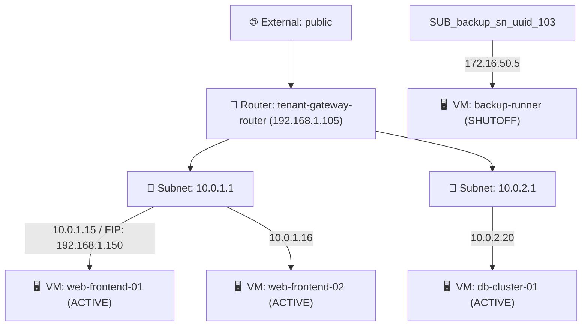

# OpenStack OVN Tenant Network Topology CLI

A fast, terminal-based visualization tool for OpenStack tenant networking and OVN (Open Virtual Network). It reconstructs and renders complete tenant network topologies directly in your console, mirroring the visual graph found in OpenStack Horizon (**Project -> Network -> Network Topology**).

Designed for **OpenStack Director (TripleO / Undercloud / Overcloud)**, standalone OpenStack installations, CI/CD pipelines, and remote terminal troubleshooting.

---

## Features

- 🖥️ **Terminal-First Visual Graph**: Reconstructs the hierarchy of External Networks, Routers, Subnets, VM instances, and Floating IPs in an intuitive Unicode tree with ANSI color coding.
- ⚡ **OVN Integration**: Automatically correlates Neutron networks and routers with their underlying OVN logical entities (`neutron-<id>` Logical Switches and Logical Routers in OVN Northbound/Southbound databases).
- 🔄 **Multiple Output Formats**:
  - `tree` *(default)*: Rich colored Unicode tree with status badges (`[ACTIVE]`, `[SHUTOFF]`, `[ERROR]`).
  - `ascii`: Plain-text ASCII tree suitable for log files, text editors, or terminals lacking Unicode support.
  - `mermaid`: Markdown flowchart diagrams ready for GitHub, GitLab, and documentation wikis.
  - `dot`: Graphviz DOT format to generate publication-grade SVG, PNG, or PDF network diagrams.
  - `json`: Structured JSON export conforming to Horizon topology data models.
- 🔒 **OpenStack & Director Authentication**: Seamlessly works with standard `overcloudrc` / `keystonerc` environment variables, `clouds.yaml`, and supports self-signed SSL endpoints (`--insecure`).
- 👥 **Multi-Tenant Administration**: Inspect specific tenant topologies with `--project <name_or_uuid>` when using administrative credentials.
- 📦 **Isolated Network Detection**: Highlights unrouted / isolated networks and attached workloads that lack router interfaces.
- 🧪 **Offline & Mock Mode**: Includes built-in realistic mock data generator (`--mock`) for local development, demos, and testing without an active OpenStack cloud.

---

## Architecture & Codebase Overview

The codebase consists of two primary files:

```text
ovn-tenant-topology/
├── ovn_tenant_topology.py       # Core application (Collector, Engine, Renderers, CLI)
├── test_ovn_tenant_topology.py  # Unit test suite covering models and all renderers
└── README.md                    # Project documentation
```

### Internal Architecture

```text
                      ┌────────────────────────────────────────┐
                      │   OpenStack Cloud / Mock Data Source   │
                      │  (Neutron, Nova, Glance/Keystone Auth) │
                      └───────────────────┬────────────────────┘
                                          │ openstacksdk
                                          ▼
                      ┌────────────────────────────────────────┐
                      │    collect_live_openstack_topology()   │
                      │  Extracts Nets, Subnets, Routers,      │
                      │  Ports, Floating IPs, and Servers      │
                      └───────────────────┬────────────────────┘
                                          │
                                          ▼
                      ┌────────────────────────────────────────┐
                      │       build_topology_from_data()       │
                      │    (Topology Graph Engine)             │
                      │  - Resolves network hierarchy          │
                      │  - Associates Floating IPs with ports  │
                      │  - Links Routers to External Gateways  │
                      │  - Identifies Isolated Networks        │
                      └───────────────────┬────────────────────┘
                                          │
                                          ▼
                      ┌────────────────────────────────────────┐
                      │             Topology Model             │
                      │  Dataclasses: SubnetInfo, PortInfo,    │
                      │  ServerInfo, NetworkInfo, RouterInfo   │
                      └───────────────────┬────────────────────┘
                                          │
            ┌──────────────┬──────────────┼──────────────┬──────────────┐
            ▼              ▼              ▼              ▼              ▼
     ┌────────────┐ ┌────────────┐ ┌────────────┐ ┌────────────┐ ┌────────────┐
     │render_tree │ │render_ascii│ │render_json │ │ render_dot │ │render_merm.│
     └────────────┘ └────────────┘ └────────────┘ └────────────┘ └────────────┘
```

### Components

1. **Data Models (`dataclasses`)**:
   - `SubnetInfo`: Represents CIDRs, gateway IPs, DHCP states, and IP allocation pools.
   - `PortInfo`: Represents neutron ports, fixed IPs, MAC addresses, device owners, and associated Floating IPs.
   - `ServerInfo`: Represents compute instances (VMs), current status (`ACTIVE`, `SHUTOFF`, etc.), and connected ports.
   - `NetworkInfo`: Represents tenant and external networks, MTUs, segmentation IDs, and provides `ovn_logical_switch` property (`neutron-<id>`).
   - `RouterInfo`: Represents neutron routers, external gateway IPs, SNAT status, router interfaces, and provides `ovn_logical_router` property (`neutron-<id>`).
   - `Topology`: Top-level graph model aggregating all interconnected components for a tenant.

2. **Graph Reconciliation Engine (`build_topology_from_data`)**:
   - Maps ports by device ownership (e.g. `compute:nova`, `network:router_interface`).
   - Pairs floating IPs with target compute instances.
   - Categorizes external vs. tenant networks and identifies isolated networks with no router interfaces attached.

3. **Renderers**:
   - `render_tree`: Colored Unicode hierarchy with gateway IP, SNAT state, floating IP pointers, and status badges.
   - `render_ascii`: ASCII tree representation for terminal pipelines and loggers.
   - `render_json`: Complete JSON dump compatible with API consumers.
   - `render_dot`: Graphviz DOT syntax using color-coded shapes (ellipses for external nets, boxes for routers/VMs).
   - `render_mermaid`: Mermaid markdown code block for documentation diagrams.

---

## Installation & Requirements

### Requirements

- **Python**: 3.8 or newer
- **OpenStack SDK**: `openstacksdk` (only required when connecting to live OpenStack environments; `--mock` runs with zero third-party dependencies).
- **Graphviz** *(optional)*: For compiling DOT diagrams into images:
  - **Debian / Ubuntu**: `sudo apt install -y graphviz`
  - **RHEL / CentOS**: `sudo dnf install -y graphviz`
  - **macOS**: `brew install graphviz`

---

### Setup Guide

#### Debian / Ubuntu

##### Option 1: Virtual Environment (Recommended)
On modern Debian (12+) and Ubuntu (22.04 / 24.04+), Python's `venv` package is separate and PEP 668 restricts non-venv global pip installs.

1. **Install Python venv and pip prerequisites:**
   ```bash
   sudo apt update
   sudo apt install -y python3-venv python3-pip
   ```

2. **Create and activate a virtual environment:**
   ```bash
   python3 -m venv .venv
   source .venv/bin/activate
   ```

3. **Install project requirements:**
   ```bash
   pip install -r requirements.txt
   ```

##### Option 2: System Package (No Virtual Environment Needed)
Install `python3-openstacksdk` directly from apt repositories:
```bash
sudo apt update
sudo apt install -y python3-openstacksdk
```

---

#### RHEL / CentOS / OpenStack Director

##### Option 1: Virtual Environment
```bash
python3 -m venv .venv
source .venv/bin/activate
pip install -r requirements.txt
```

##### Option 2: System Package
```bash
sudo dnf install -y python3-openstacksdk
```

---

#### macOS / Other Platforms

```bash
python3 -m venv .venv
source .venv/bin/activate
pip install -r requirements.txt
```

---

## Quickstart

### 1. Test Instantly with Mock Data (No OpenStack Required)

You can run the script right now without OpenStack credentials to test all features:

```bash
python3 ovn_tenant_topology.py --mock
```

Sample output:
```text
==============================================================================
OpenStack Tenant Network Topology | Project: demo (demo-tenant-4a8b-1234)
Region: regionOne | Auth URL: https://overcloud.local:13000/v3
==============================================================================

🌐 External Network: public (192.168.1.0/24) [ACTIVE]
└── 🔀 Router: tenant-gateway-router [ACTIVE] (Gateway: 192.168.1.105 | SNAT: enabled)
    ├── 🔌 Subnet: app-internal-net / 10.0.1.0/24 (GW: 10.0.1.1)
    │   ├── 🖥️  web-frontend-01 [ACTIVE] [10.0.1.15] ➜ 🌐 Floating IP: 192.168.1.150
    │   └── 🖥️  web-frontend-02 [ACTIVE] [10.0.1.16]
    └── 🔌 Subnet: db-backend-net / 10.0.2.0/24 (GW: 10.0.2.1)
        └── 🖥️  db-cluster-01 [ACTIVE] [10.0.2.20]

📦 Isolated / Unrouted Networks (No Router Interface):
└── 🔌 Network: isolated-backup-net [ACTIVE] [backup-subnet (172.16.50.0/24)]
    └── 🖥️  backup-runner [SHUTOFF] [172.16.50.5]
```

### 2. Connect to an OpenStack Environment

Source your OpenStack RC file (e.g., Director overcloudrc or project RC):

```bash
source ~/overcloudrc
# or
source ~/myprojectrc

# Run the CLI
python3 ovn_tenant_topology.py
```

If your OpenStack deployment uses self-signed SSL certificates:
```bash
python3 ovn_tenant_topology.py --insecure
```

---

## CLI Usage & Options

```text
usage: ovn_tenant_topology.py [-h] [-f {tree,ascii,json,dot,mermaid}]
                             [--project PROJECT] [--cloud CLOUD_NAME] [-k]
                             [--ovn-details] [--no-color] [-v] [--mock]
```

| Flag | Description |
|---|---|
| `-f, --format FORMAT` | Output format: `tree` (default), `ascii`, `json`, `dot`, `mermaid` |
| `--project PROJECT` | Target project name or UUID (requires admin credentials) |
| `--cloud CLOUD_NAME` | Named cloud entry defined in `~/.config/openstack/clouds.yaml` |
| `-k, --insecure` | Explicitly trust self-signed / untrusted SSL certificates |
| `--ovn-details` | Include OVN logical switch (`neutron-<net_id>`) and logical router (`neutron-<rtr_id>`) identifiers |
| `-v, --verbose` | Show additional port details such as MAC addresses |
| `--no-color` | Disable ANSI color sequences in output |
| `--mock` | Run with sample topology data without querying OpenStack |

---

## Usage Examples

### 1. Inspect OVN Logical Entities

Add `--ovn-details` to view the underlying OVN logical switches and routers:

```bash
python3 ovn_tenant_topology.py --ovn-details
```

Output includes:
```text
└── 🔀 Router: tenant-gateway-router [ACTIVE] (...) [OVN LR: neutron-router-uuid-001]
    ├── 🔌 Subnet: app-internal-net / 10.0.1.0/24 (...) [OVN LS: neutron-tenant-net-uuid-101]
```

You can then directly correlate these with OVN CLI utilities on your controller/hypervisor:
```bash
sudo ovn-nbctl show neutron-router-uuid-001
sudo ovn-nbctl lr-nat-list neutron-router-uuid-001
sudo ovn-sbctl show
```

### 2. Generate Graphviz SVG / PNG Network Diagrams

Export the topology to DOT and pipe into Graphviz:

```bash
# Render to SVG
python3 ovn_tenant_topology.py --format dot | dot -Tsvg -o topology.svg

# Render to PNG
python3 ovn_tenant_topology.py --format dot | dot -Tpng -o topology.png
```

### 3. Generate Mermaid Diagrams for Markdown

```bash
python3 ovn_tenant_topology.py --format mermaid > topology.md
```

Generates:


### 4. Plain ASCII for Automated Log Files

```bash
python3 ovn_tenant_topology.py --format ascii
```

Output:
```text
=== OpenStack Tenant Topology: demo (demo-tenant-4a8b-1234) ===

[EXT: public] (192.168.1.0/24) [ACTIVE]
  \-- [ROUTER: tenant-gateway-router] [ACTIVE] (GW: 192.168.1.105, snat:on)
      +-- [SUBNET: app-internal-net] (IP: 10.0.1.1)
      |   +-- [VM: web-frontend-01] [ACTIVE] (IP: 10.0.1.15) <=> [FIP: 192.168.1.150]
      |   \-- [VM: web-frontend-02] [ACTIVE] (IP: 10.0.1.16)
      \-- [SUBNET: db-backend-net] (IP: 10.0.2.1)
          \-- [VM: db-cluster-01] [ACTIVE] (IP: 10.0.2.20)

[ISOLATED NETWORKS]
  +-- [NET: isolated-backup-net] (172.16.50.0/24)
      +-- [VM: backup-runner] [SHUTOFF] (IP: 172.16.50.5)
```

### 5. Export JSON for Scripting

```bash
python3 ovn_tenant_topology.py --format json | jq '.routers'
```

---

## Running Unit Tests

The repository includes a comprehensive unit test suite in [test_ovn_tenant_topology.py](test_ovn_tenant_topology.py) testing graph model construction, router linkings, floating IPs, isolated subnets, and all rendering format outputs.

Run the tests using Python's standard `unittest` module:

```bash
python3 -m unittest test_ovn_tenant_topology.py
```

Expected output:
```text
......
----------------------------------------------------------------------
Ran 6 tests in 0.001s

OK
```

---

## License

Licensed under the Apache License, Version 2.0. See the file header for license details.
